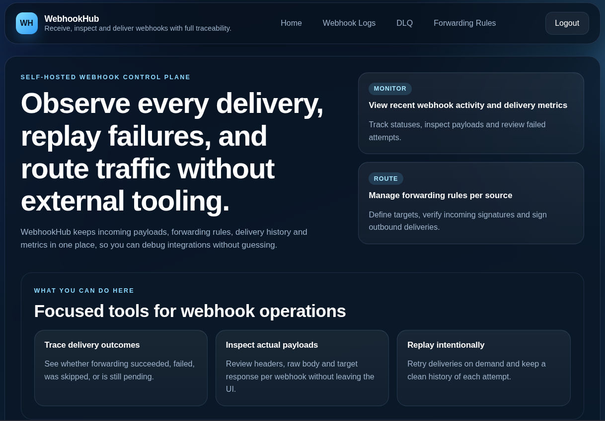

# WebhookHub

WebhookHub is a self-hosted service for receiving, inspecting and forwarding
webhooks. It saves incoming events in PostgreSQL, delivers them to your service,
and keeps delivery history so you can investigate failures and replay events.

Built with Go, PostgreSQL and a server-rendered HTML + HTMX dashboard. Runs as a
single application with PostgreSQL; Docker Compose is included.



## Use cases

- **Debug integrations:** inspect request payloads and headers, examine each
  delivery attempt and its response, then Replay an event after fixing your code.
- **Keep an incoming event journal:** collect webhooks from multiple sources in
  one place and search by source, status, text or time range.
- **Recover failed deliveries:** retry automatically with backoff, then review
  exhausted deliveries in the dead-letter queue (DLQ) and requeue them after
  fixing the receiver.

See [use cases](docs/use-cases.md) for development and deployment workflows.

## Features

- Receive and persist events at `POST /hook/{source}` with payloads, headers and
  timestamps.
- Configure one forwarding target per source, with optional incoming HMAC
  verification and outgoing signing in Stripe-style format.
- Pause and resume delivery per source while continuing to receive events;
  see the queued event count beside each rule.
- Track delivery status and metrics; retry with configurable attempts and backoff.
- Replay individual events or requeue up to 20 selected DLQ events at a time,
  keeping attempt history.
- Inspect request bodies, delivery attempts and saved response headers and bodies;
  download an individual payload as its original bytes.
- Search and filter logs with pagination, timezone-aware dates and shareable URLs;
  pause automatic dashboard updates when investigating an event.
- Read events through a paginated JSON API and optionally remove old events with
  retention cleanup.
- Use a single admin login with session cookies and CSRF protection, plus process
  and database health checks.

Delivery is asynchronous and at-least-once: duplicates are possible, so receivers
must tolerate them. Each source maps to one target. Only HTTP `2xx` counts as
successful delivery; redirects are saved as failures. See
[delivery behavior](docs/operations.md#delivery-behavior).

## Quick start

Requires Docker with the Compose plugin. Clone the repository and copy the
configuration template:

```bash
git clone https://github.com/Paramoshka/WebhookHub.git
cd WebhookHub
cp .env.sample .env
```

Edit `.env`: set `ADMIN_EMAIL`, an `ADMIN_PASSWORD` of at least 12 characters, a
random `POSTGRES_PASSWORD`, and `SESSION_KEY`. Generate the session key with:

```bash
openssl rand -hex 32
```

Paste the output into `SESSION_KEY`. Keep the sample PostgreSQL host `db`, port
`5432`, user and database name for this Compose setup. Keep `COOKIE_SECURE=false`
for local HTTP; use `true` behind HTTPS in production. See
[configuration](docs/operations.md#configuration) for all settings.

```bash
docker compose up -d --build
```

1. Open [the dashboard](http://localhost:8080/dashboard) and log in with the admin
   credentials from `.env`.
2. Open **Forwarding Rules** (`/forwarding`). Add source `demo` and the absolute
   HTTP(S) URL of a receiver reachable from the application container. For a
   receiver in another Compose service, use its service name and container port;
   `localhost` inside the container refers to WebhookHub itself. Leave HMAC fields
   empty for this first test.
3. Send an event:

   ```bash
   curl -i http://localhost:8080/hook/demo \
     -H 'Content-Type: application/json' \
     --data '{"event":"demo.created","id":"example-1"}'
   ```

4. A `202 Accepted` response confirms storage. Open **Inspect** on the dashboard
   to check the delivery status and the receiver's saved response. After fixing a
   failed receiver, use **Replay** to queue another delivery.

Without a forwarding rule the event is still saved and becomes `skipped`; add a
rule and Replay it when ready. External providers need a publicly reachable
callback URL; see [local tunneling](docs/ngrok-guide.md).

## Documentation

- [Use cases](docs/use-cases.md)
- [Configure forwarding](docs/forwarding-ui.md)
- [UI and HTTP reference](docs/reference.md) — Inspect, DLQ recovery, signatures,
  API pagination, filters and timezones
- [Operations](docs/operations.md) — configuration, proxy setup, delivery workers,
  health checks, retention and upgrade notes
- [Local tunneling](docs/ngrok-guide.md)
- [Project structure](docs/project-structure.md)

## License

Copyright (C) 2025-2026 Ivan Parfenov.

WebhookHub is available under two licensing options:

1. **Open-source license:** [GNU AGPL v3 only](LICENSE). You may use, modify,
   distribute, and operate WebhookHub commercially under the AGPL. If you
   modify it and users interact with your version over a network, section 13
   requires you to prominently offer those users the corresponding source code
   at no charge.
2. **Commercial license:** alternative terms are available for users that want
   to keep their modifications closed or cannot comply with the
   AGPL. Contact
   [ivan.parfenov.42a@gmail.com](mailto:ivan.parfenov.42a@gmail.com).

Commercial use does not by itself require a commercial license. Third-party
dependencies remain subject to their own licenses.

Contributions are accepted under the [Contributor License Agreement](CLA.md)
and the process described in [CONTRIBUTING.md](CONTRIBUTING.md).

### Vendored frontend dependency

htmx is served locally and embedded in the application. See [version, provenance, license and update procedure](docs/vendor-htmx.md).
